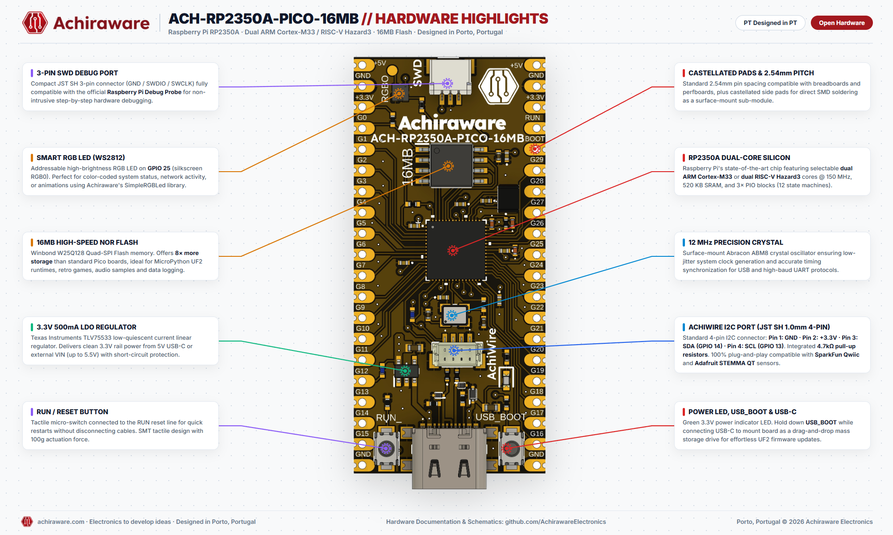
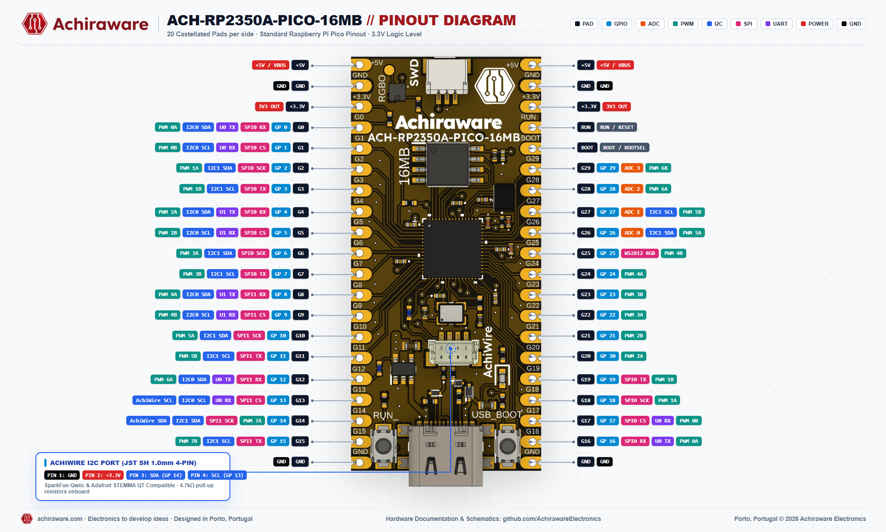

<div align="center">

# ACH-RP2350A-PICO-16MB

**Raspberry Pi RP2350A Development Board with 16MB Flash, Dual ARM/RISC-V, Hardware SWD & Solderless I2C**

[](#hardware-files)
[](https://achiraware.com)
[](https://achiraware.com)
[](#quickstart-guide)
[](https://achiraware.com/product/ach-rp2350a-pico-16mb/)

<br>



</div>

---

## 📖 Overview

The **ACH-RP2350A-PICO-16MB** by **Achiraware Electronics** is a high-performance, next-generation development board based on the brand new **Raspberry Pi RP2350A** microcontroller. Designed and hand-assembled in Vila Nova de Gaia / Porto, Portugal, it elevates the standard Raspberry Pi Pico format into a rugged, full-featured developer platform for makers, educators, and embedded hardware engineers.

Featuring **selectable dual-core architecture** (dual ARM Cortex-M33 or dual Hazard3 RISC-V cores @ 150 MHz) and an upgraded **16 MB Quad-SPI NOR Flash** (8× more than standard 2MB Pico boards), it provides ample headroom for complex MicroPython / CircuitPython projects, retro gaming emulation, high-sample audio DSP, and high-speed data acquisition.

### Key Highlights
- **State-of-the-Art Silicon:** Raspberry Pi RP2350A with hardware floating point, DSP instructions, and enhanced security (TrustZone).
- **8× Flash Storage:** Winbond 16 MB QSPI Flash for massive file storage, assets, and UF2 firmware payloads.
- **Dedicated 3-Pin SWD Debug Port:** Standard JST SH 1.0mm 3-pin connector (GND / SWDIO / SWCLK) fully plug-and-play compatible with the official **Raspberry Pi Debug Probe**.
- **AchiWire Plug-and-Play I2C:** Onboard JST SH 1.0mm 4-pin port with 4.7kΩ pull-up resistors for instant connection to **SparkFun Qwiic** and **Adafruit STEMMA QT** sensor ecosystems.
- **Addressable Smart RGB LED:** WS2812 high-brightness LED on **GPIO 25** for animated status feedback.
- **Dedicated RUN & BOOT Buttons:** No need to unplug the USB-C cable to enter flashing mode or restart your firmware.

---

## 📐 Hardware Architecture & Highlights

| Feature | Specification |
|:---|:---|
| **Microcontroller** | Raspberry Pi RP2350A (Selectable Dual ARM Cortex-M33 / Dual RISC-V Hazard3 @ 150 MHz) |
| **SRAM** | 520 KB on-chip SRAM in 10 independently accessible banks |
| **Programmable I/O** | 3× PIO blocks (12 state machines total) for custom protocol emulation |
| **Flash Memory** | 16 MB Winbond W25Q128 Quad-SPI NOR Flash |
| **Clock Source** | Abracon ABM8 12.000 MHz precision surface-mount crystal oscillator |
| **Power Input (VIN)** | 3.3V to 5.5V via VIN/VBUS pins or 5V via USB-C |
| **Voltage Regulator** | Texas Instruments TLV75533 (3.3V @ 500 mA output with overcurrent protection) |
| **USB Interface** | Full 16-pin USB Type-C (USB 1.1 Host/Device) with UF2 drag-and-drop bootloader support |
| **I2C Connector** | JST SH 1.0mm 4-Pin AchiWire Port (Qwiic / STEMMA QT compatible, 4.7kΩ pull-ups) |
| **Debug Connector** | JST SH 1.0mm 3-Pin SWD Port (GND, SWDIO, SWCLK) for Raspberry Pi Debug Probe |
| **Indicators** | Green Power LED (3.3V rail) + Addressable WS2812 Smart RGB LED (GPIO 25) |
| **Buttons** | Subminiature Tactile RUN (Hardware Reset) + BOOT (BOOTSEL) buttons |
| **Form Factor** | Pico footprint (40 pins, 2.54 mm pitch through-hole + castellated SMD edge pads) |

---

## 📌 Pinout Diagram & Reference

<div align="center">

</div>

### 🔌 AchiWire I2C Connector (JST SH 1.0mm 4-Pin)
Connect any SparkFun Qwiic or Adafruit STEMMA QT sensor board without soldering:

| Pin # | Wire Color | Signal | Notes |
|:---:|:---:|:---|:---|
| **1** | Black | **GND** | System Ground |
| **2** | Red | **+3.3V** | 3.3V Regulated Rail |
| **3** | Blue | **SDA (GP 14)** | I2C1 Data Line (integrated 4.7kΩ pull-up) |
| **4** | Yellow | **SCL (GP 13)** | I2C0 Clock Line (integrated 4.7kΩ pull-up) |

### 🛠️ Hardware SWD Debug Port (JST SH 1.0mm 3-Pin)
| Pin # | Signal | Raspberry Pi Debug Probe Wire |
|:---:|:---|:---|
| **1** | **GND** | Black (Ground) |
| **2** | **SWDIO** | Yellow (Data) |
| **3** | **SWCLK** | Orange (Clock) |

---

### 📋 Full 40-Pin Header Mapping

#### Left Header (Pins 1 – 20)
| Pin # | Silkscreen | GP Pin | Primary Function | Alternate Peripherals |
|:---:|:---|:---|:---|:---|
| 1 | **+5V** | - | 5V / VBUS Input | USB VBUS / External 5V Power Supply |
| 2 | **GND** | - | Power Ground | 0V Reference |
| 3 | **3V3** | - | +3.3V Output | Regulated 3.3V Rail (up to 500 mA) |
| 4 | **G0** | GP 0 | Digital I/O | SPI0 RX, UART0 TX, I2C0 SDA, PWM 0A |
| 5 | **G1** | GP 1 | Digital I/O | SPI0 CS, UART0 RX, I2C0 SCL, PWM 0B |
| 6 | **G2** | GP 2 | Digital I/O | SPI0 SCK, I2C1 SDA, PWM 1A |
| 7 | **G3** | GP 3 | Digital I/O | SPI0 TX, I2C1 SCL, PWM 1B |
| 8 | **G4** | GP 4 | Digital I/O | SPI0 RX, UART1 TX, I2C0 SDA, PWM 2A |
| 9 | **G5** | GP 5 | Digital I/O | SPI0 CS, UART1 RX, I2C0 SCL, PWM 2B |
| 10 | **G6** | GP 6 | Digital I/O | SPI0 SCK, I2C1 SDA, PWM 3A |
| 11 | **G7** | GP 7 | Digital I/O | SPI0 TX, I2C1 SCL, PWM 3B |
| 12 | **G8** | GP 8 | Digital I/O | SPI1 RX, UART1 TX, I2C0 SDA, PWM 4A |
| 13 | **G9** | GP 9 | Digital I/O | SPI1 CS, UART1 RX, I2C0 SCL, PWM 4B |
| 14 | **G10** | GP 10 | Digital I/O | SPI1 SCK, I2C1 SDA, PWM 5A |
| 15 | **G11** | GP 11 | Digital I/O | SPI1 TX, I2C1 SCL, PWM 5B |
| 16 | **G12** | GP 12 | Digital I/O | SPI1 RX, UART0 TX, I2C0 SDA, PWM 6A |
| 17 | **G13** | GP 13 | AchiWire SCL | SPI1 CS, UART0 RX, I2C0 SCL, PWM 6B |
| 18 | **G14** | GP 14 | AchiWire SDA | SPI1 SCK, I2C1 SDA, PWM 7A |
| 19 | **G15** | GP 15 | Digital I/O | SPI1 TX, I2C1 SCL, PWM 7B |
| 20 | **GND** | - | Power Ground | 0V Reference |

#### Right Header (Pins 21 – 40)
| Pin # | Silkscreen | GP Pin | Primary Function | Alternate Peripherals |
|:---:|:---|:---|:---|:---|
| 21 | **+5V** | - | 5V / VBUS | Tied to Pin 1 / VBUS |
| 22 | **GND** | - | Power Ground | 0V Reference |
| 23 | **3V3** | - | +3.3V Output | Regulated 3.3V Rail |
| 24 | **RUN** | - | RUN / RESET | Hardware Reset Line (active low) |
| 25 | **BOOT** | - | BOOT / BOOTSEL | Force USB Mass Storage Bootloader |
| 26 | **G29** | GP 29 | ADC 3 / I/O | Analog In 3, PWM 6B |
| 27 | **G28** | GP 28 | ADC 2 / I/O | Analog In 2, PWM 6A |
| 28 | **G27** | GP 27 | ADC 1 / I/O | Analog In 1, I2C1 SCL, PWM 5B |
| 29 | **G26** | GP 26 | ADC 0 / I/O | Analog In 0, I2C1 SDA, PWM 5A |
| 30 | **G25** | GP 25 | WS2812 RGB LED | Onboard Addressable RGB, PWM 4B |
| 31 | **G24** | GP 24 | Digital I/O | PWM 4A |
| 32 | **G23** | GP 23 | Digital I/O | PWM 3B |
| 33 | **G22** | GP 22 | Digital I/O | PWM 3A |
| 34 | **G21** | GP 21 | Digital I/O | PWM 2B |
| 35 | **G20** | GP 20 | Digital I/O | PWM 2A |
| 36 | **G19** | GP 19 | Digital I/O | SPI0 TX, PWM 1B |
| 37 | **G18** | GP 18 | Digital I/O | SPI0 SCK, PWM 1A |
| 38 | **G17** | GP 17 | Digital I/O | SPI0 CS, UART0 RX, PWM 0B |
| 39 | **G16** | GP 16 | Digital I/O | SPI0 RX, UART0 TX, PWM 0A |
| 40 | **GND** | - | Power Ground | 0V Reference |

---

## 🚀 Quickstart Guide

### 1. Drag & Drop UF2 Firmware Updates
1. Hold down the onboard **BOOT** button.
2. Plug the USB-C cable into your computer.
3. Release the **BOOT** button. The board will mount as a USB mass storage drive (`RP2350` or `RPI-RP2`).
4. Simply drag and drop any compiled `.uf2` file onto the drive! The board automatically resets and runs your code.

---

### 2. MicroPython Setup

1. Download the official Raspberry Pi RP2350 MicroPython UF2 build from [micropython.org](https://micropython.org/download/RPI_PICO2/).
2. Drag and drop the `.uf2` file onto the mounted drive.
3. Open **Thonny IDE** or your preferred serial terminal at 115200 baud.
4. Blink the onboard WS2812 RGB LED:
   ```python
   import machine, neopixel, time
   
   # WS2812 is mapped to GP 25
   np = neopixel.NeoPixel(machine.Pin(25), 1)

   while True:
       # Achiraware Crimson Red
       np[0] = (163, 24, 30)
       np.write()
       time.sleep(1)

       # Cyan Blue
       np[0] = (0, 229, 255)
       np.write()
       time.sleep(1)

       # Amber Gold
       np[0] = (245, 166, 35)
       np.write()
       time.sleep(1)
   ```

5. Scan the AchiWire I2C port:
   ```python
   from machine import Pin, I2C

   # AchiWire Port: SDA = GP14, SCL = GP13
   i2c = I2C(1, scl=Pin(13), sda=Pin(14), freq=400000)
   print("Scanning AchiWire I2C bus...")
   devices = i2c.scan()
   if devices:
       for d in devices:
           print("Found device at:", hex(d))
   else:
       print("No I2C devices found.")
   ```

---

### 3. Arduino IDE (Raspberry Pi Pico / RP2350 Core by Earle Philhower)

1. In Arduino IDE, open **Preferences** and add the Earle Philhower board index:
   ```
   https://github.com/earlephilhower/arduino-pico/releases/download/global/package_rp2040_index.json
   ```
2. In **Boards Manager**, search for `RP2040 / RP2350` and install the package.
3. Select **Tools > Board > Raspberry Pi Pico 2**.
4. Set **Flash Size** to `16MB (FS: 2MB, OTA: ~7MB)`.

---

## 📁 Hardware & Design Files

| File | Description | Download Link |
|:---|:---|:---:|
| **Schematic (PDF)** | Complete electrical schematic diagram | [ACH-RP2350A-PICO-16MB-schematic.pdf](hardware/ACH-RP2350A-PICO-16MB-schematic.pdf) |
| **3D CAD Model (STEP)** | 3D mechanical model for enclosure 3D printing | [ACH-RP2350A-PICO-16MB.step](hardware/ACH-RP2350A-PICO-16MB.step) |
| **Board Outline (DXF)** | Mechanical dimension drawing | [ACH-RP2350A-PICO-16MB.dxf](hardware/ACH-RP2350A-PICO-16MB.dxf) |
| **Ultra HD Highlights** | 2000x1200 Architecture breakdown infographic | [Highlights PNG](hardware/ACH-RP2350A-PICO-16MB_Hardware_Highlights.png) |
| **Ultra HD Pinout** | 2000x1200 Full pinout reference diagram | [Pinout PNG](hardware/ACH-RP2350A-PICO-16MB-pinout.png) |

---

## 🛒 Where to Buy

Get authentic, factory-tested boards shipped directly from Porto, Portugal:

👉 **[Official Achiraware Store — Buy ACH-RP2350A-PICO-16MB](https://achiraware.com/product/ach-rp2350a-pico-16mb/)**

- **Worldwide & Fast EU Shipping:** Shipped via registered mail / courier across Europe and globally.
- **Support & Inquiries:** [customerservice@achiraware.com](mailto:customerservice@achiraware.com) | [achiraware.com](https://achiraware.com)

---

## 📄 License & Attribution

Designed and open-sourced by **Achiraware Electronics** (Vila Nova de Gaia / Porto, Portugal).  
Hardware documentation and design files are released under the **CERN Open Hardware Licence v2 - Permissive** (CERN-OHL-P). Software libraries and example code are licensed under the **MIT License**.
